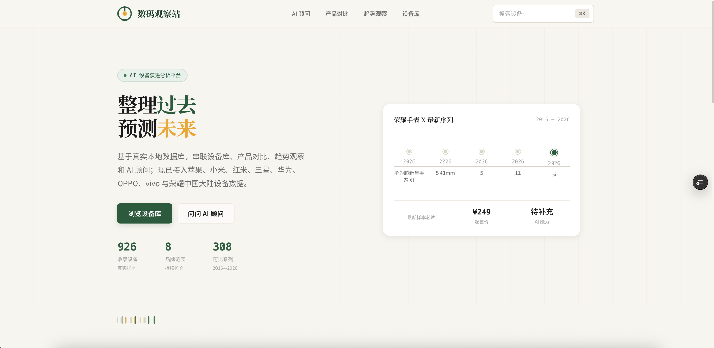
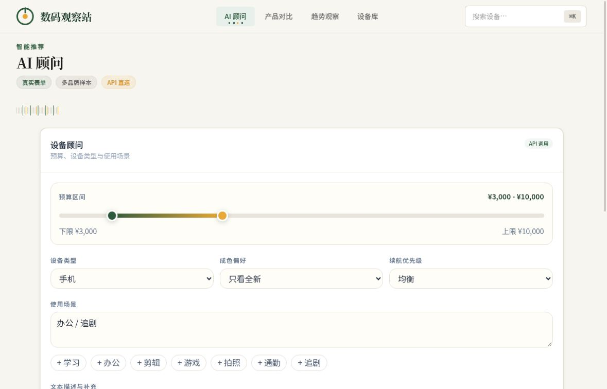
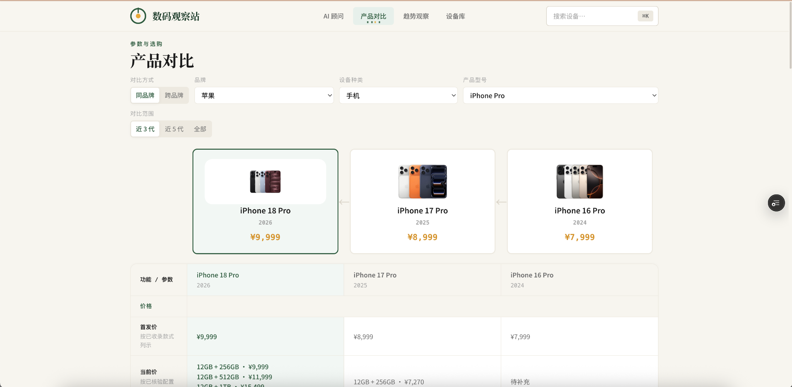
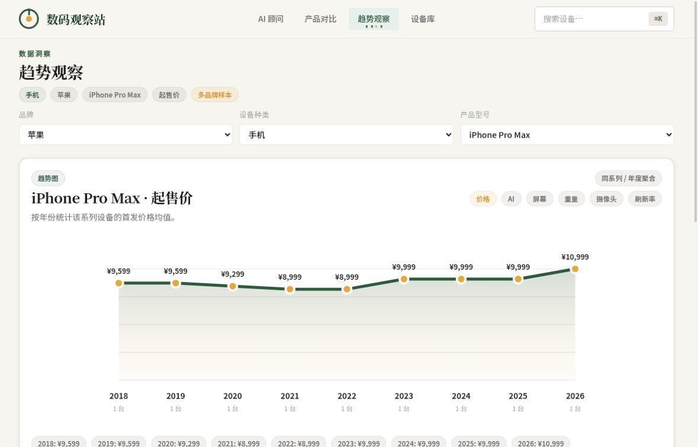
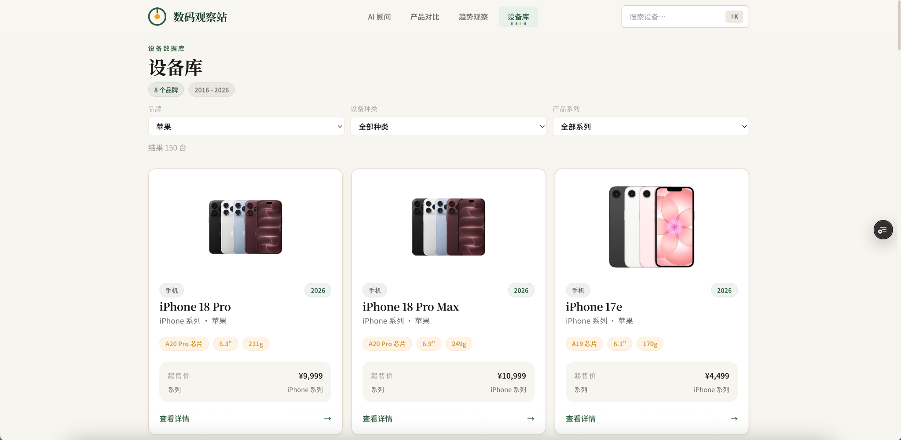
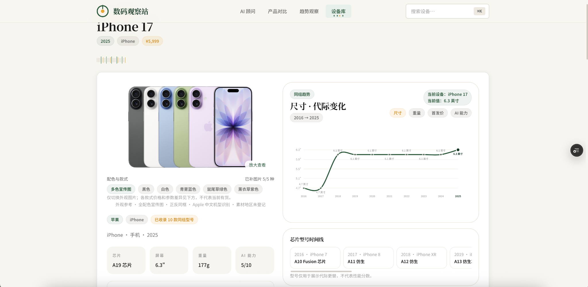
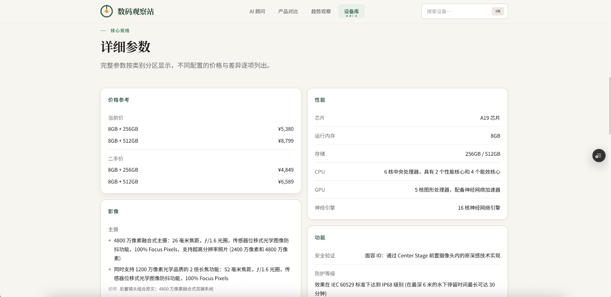

# DeviceScope

[简体中文](README.md) | [English](README.en.md)

> **License:** Original software and original technical documentation are [MIT licensed](LICENSE). Third-party code, dependencies, fonts, images, databases, audiovisual materials and hardware retain their own rights. See [license scope](LICENSE_SCOPE.md).

DeviceScope is a web application for browsing device specifications, comparing products, viewing historical price and specification trends, and exploring AI-assisted device suggestions. It presents structured records with source metadata; it is not a real-time price tracker, benchmark suite, or guarantee of product suitability.

- Existing project demo: [ai-device-evolution.vercel.app](https://ai-device-evolution.vercel.app/). The deployed site may not match this source candidate.
- Existing repository reference: [LighthouseXy/ai-device-evolution](https://github.com/LighthouseXy/ai-device-evolution). Check its current release and licensing status before relying on it.

## What the candidate does

- Browses Apple, Xiaomi, Redmi, Samsung, Huawei, OPPO, vivo, and HONOR devices across phones, tablets, laptops, watches, and bands.
- Filters from brand to device type to product series, then compares two or three devices in the same category. Comparisons can be within or across brands.
- Displays specifications, recorded configurations, prices, sources, and available product imagery. Missing fields are not meant to be inferred from similar models.
- Records same-model feature configurations such as NFC or eSIM in device details rather than automatically splitting them into separate model entries. Physical size, generation, and other model distinctions follow the available source data; this does not imply a blanket normalization rule.
- Shows historical trends for selected brands, categories, series, and measures. Different price types are not presented as live market prices.
- Provides an AI-assisted advisor that evaluates a limited candidate set and can return up to three suggestions. The server checks device and price references and can fall back to rules when a model is unavailable; these checks do not establish that every generated statement is correct.

The comparison and trend-page text insights are local rules, not live model output. An AI-analysis API exists, but product comparisons are not connected to a live AI analysis flow in this candidate.

## Screenshots

Five images below were provided by the user on 2026-10-21; their exact capture times and page URLs were not supplied. The advisor input and trends images are retained cloud captures with separate provenance. Original bytes are preserved. These images do not establish rights to third-party product photos, logos, specifications, or prices. See [image provenance](docs/screenshots/ai-device/README.md).


*User-provided capture dated 2026-10-21. The home timeline/series mismatch shown here is a known issue and has not been fixed in this candidate.*


*Candidate UI capture of the idle input form; no recommendation has been generated.*


*User-provided capture dated 2026-10-21.*


*Candidate trends-page capture. It shows one annual sample for each year from 2018 to 2026; it is not a forecast or independent market analysis.*


*User-provided capture dated 2026-10-21.*


*User-provided capture dated 2026-10-21.*


*User-provided capture dated 2026-10-21.*

## Language

The interface is primarily Chinese. English field keys or a separately retained Apple en-US source snapshot do not amount to an English UI or complete English localization. This README is English-language documentation only.

## Technology

- Next.js 16, React 19, TypeScript, and Tailwind CSS 4
- Local JSON datasets and source metadata; a build script assembles the device database
- Node-based validation and regression scripts
- Optional OpenAI / DeepSeek-backed advisor configuration, with a rules fallback

## Run locally

Use Node.js 24 and npm 11 with the existing `package-lock.json`. These commands match the current default branch:

```sh
npm ci --ignore-scripts --no-audit --no-fund
npm run build:data
npm run typecheck
npm run lint
NEXT_TELEMETRY_DISABLED=1 OPENAI_API_KEY= DEEPSEEK_API_KEY= npm run build -- --webpack
npm start
```

For development, run `npm run dev` and open `http://localhost:3000`. Dependency installation requires the npm registry or a complete local cache.

The full `npm run check` suite includes historical source/image evidence checks that may require private local caches. Missing evidence is not a passing test. The standalone validator and complete synthetic-data application are separate preparation candidates; their new scripts are not added by this documentation commit and are not presented here as available on the default branch.

## Configuration and safety

The build and offline checks do not need model credentials. If an authorized deployment uses the optional model-backed advisor, configure its provider key only in a private local or deployment environment (for example, an untracked `.env.local`); never commit secrets, `.env` files, user data, or paid evaluation results. With no model key, the advisor can use its rules fallback.

Production data includes dated public-price snapshots rather than live offers. Do not run collection or synchronization scripts against external services without reviewing their scope and obtaining the required authorization. Source URLs and hashes help trace records but do not prove factual accuracy or publication rights.

## Data and known limitations

The candidate contains a substantial production catalog and image metadata, but its own audits mark coverage as partial. It does not claim every model, configuration, color, or year is covered. Price records are dated snapshots, primarily from publicly listed mainland China offers; second-hand prices are lightweight references, not current valuations. Missing values may remain blank.

The home page has a known timeline issue: its heading can identify one product series while the timeline entries include devices from other brands or series. The issue is deferred and was not fixed in this candidate. The home screenshot above shows this mismatch; it is not fixed in the candidate.

The advisor's candidate limits and reference checks do not verify all natural-language claims. The trends view is descriptive and should not be used as a price forecast or investment advice. Product imagery, trademarks, data, quotations, external text, and dependencies may each have separate rights or notice requirements.

## Tests, maintenance, and contributions

Available checks include `npm run typecheck`, `npm run lint`, `npm run test:device-advisor`, and `npm run test:device-advisor-api`. These are code and mock/regression checks, not real-model quality measurements. Ensure the required historical evidence is available before running the broader `npm run check` suite.

Project-owned software and original technical documents in the scope list use MIT. Before contributing, confirm the maintainers' current contribution workflow and that you have rights to the material you provide. Data changes should include source, date, region, and configuration context; preserve unknowns rather than extrapolating. Image contributions need asset-specific author, source, and license evidence. Do not submit credentials, personal data, uncleared third-party originals, or paid API outputs.

## License and rights

The root [LICENSE](LICENSE) contains standard MIT with Copyright (c) 2026 LighthouseXy for project-owned software and original technical-document portions. It permits commercial use, modification and redistribution subject to its copyright/permission notice; no additional noncommercial condition is imposed on that scope.

Third-party code, dependencies, fonts, photographs, screenshots, logos, production databases, quotations, audiovisual material and hardware retain their separate rights and notices. They are not automatically covered by project MIT. See [LICENSE_SCOPE.md](LICENSE_SCOPE.md), [LICENSE_SCOPE.json](LICENSE_SCOPE.json) and [THIRD_PARTY_NOTICES.md](THIRD_PARTY_NOTICES.md) for actual remote paths and boundaries. The separately prepared synthetic application candidate is not published by this license-only commit, and its local-only scripts/data are not required by this README.
