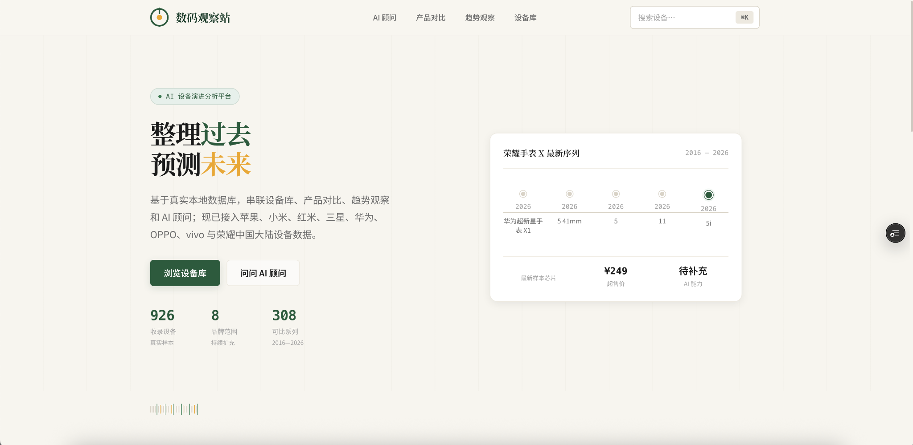
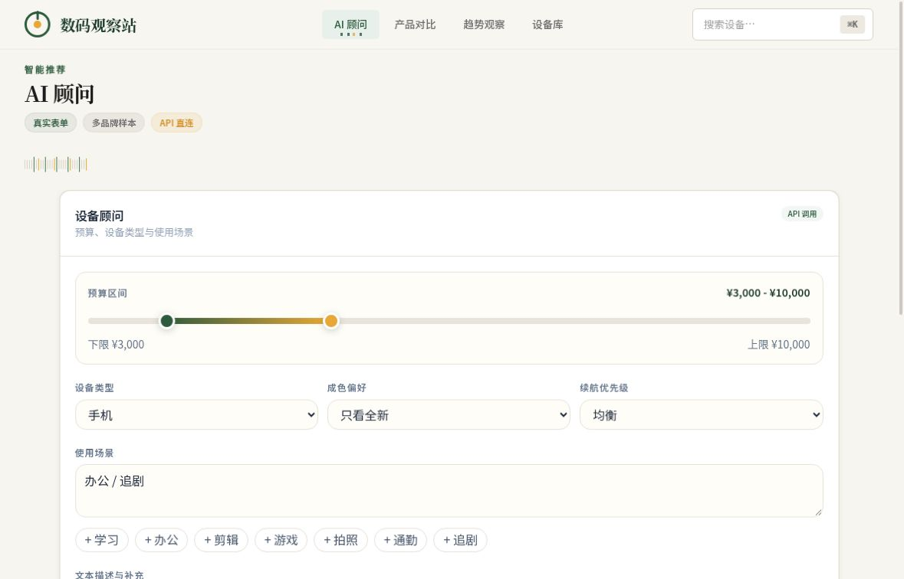
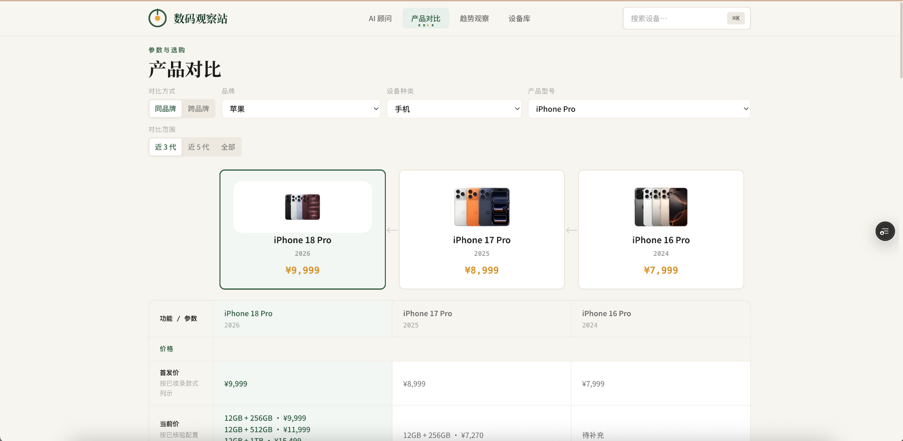
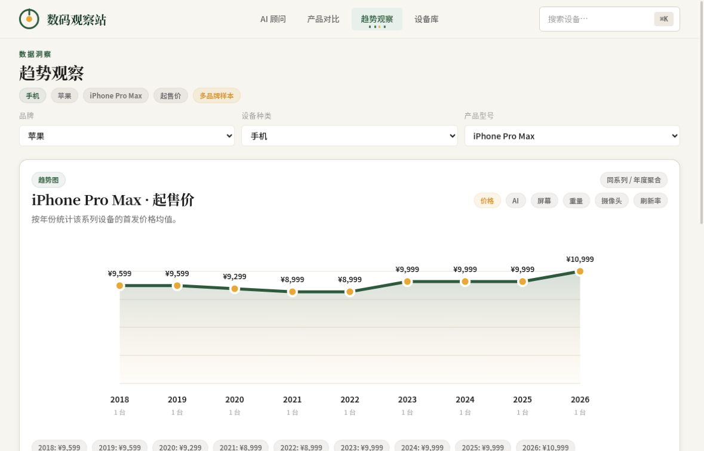
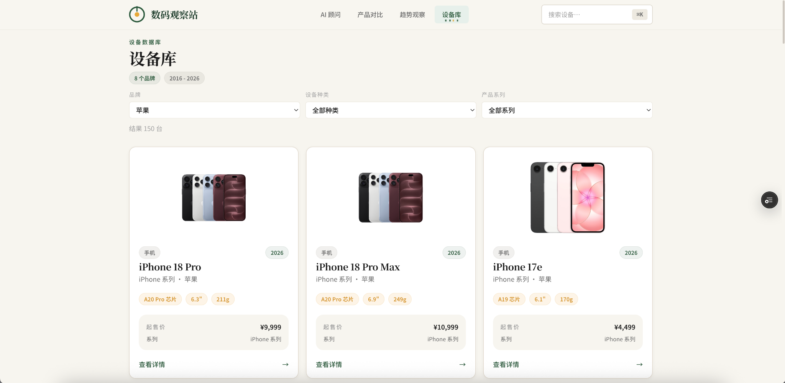
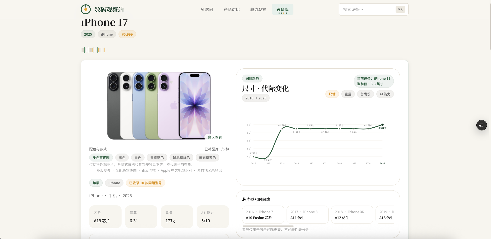
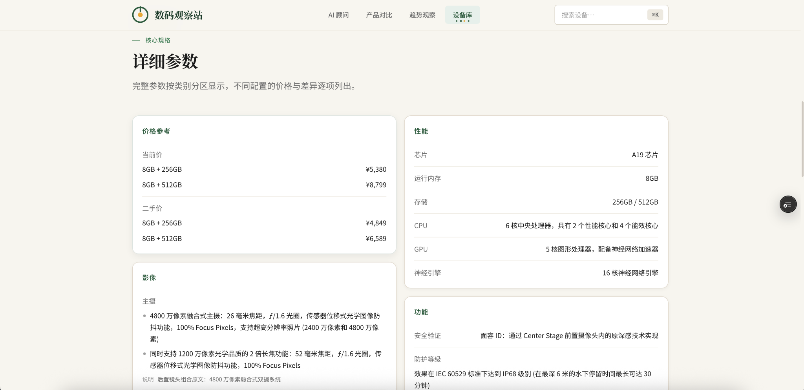

# DeviceScope

[English](README.md) | [简体中文](README.zh-CN.md)

[Development history](DEVELOPMENT_HISTORY.en.md): feature, maintenance and documentation progress grounded in actual commits and diffs.

> **License:** Original software and original technical documentation are [MIT licensed](LICENSE). Third-party code, dependencies, fonts, images, databases, audiovisual materials and hardware retain their own rights. See [license scope](LICENSE_SCOPE.md).

DeviceScope is a web application for browsing device specifications, comparing products, viewing historical price and specification trends, and exploring AI-assisted device suggestions. It presents structured records with source metadata and dated price snapshots. Performance testing and suitability for a particular use require separate evaluation.

- Existing project demo: [ai-device-evolution.vercel.app](https://ai-device-evolution.vercel.app/). The deployed site and this source candidate may be different versions.
- Existing repository reference: [LighthouseXy/ai-device-evolution](https://github.com/LighthouseXy/ai-device-evolution). Check its current release and licensing status before relying on it.

## What the candidate does

- Browses Apple, Xiaomi, Redmi, Samsung, Huawei, OPPO, vivo, and HONOR devices across phones, tablets, laptops, watches, and bands.
- Filters from brand to device type to product series, then compares two or three devices in the same category. Comparisons can be within or across brands.
- Displays specifications, recorded configurations, prices, sources, and available product imagery. Missing fields remain unknown and need model-specific evidence.
- Records same-model feature configurations such as NFC or eSIM in device details without automatically splitting them into separate model entries. Physical size, generation, and other model distinctions follow the available source data for each model.
- Shows historical trends for selected brands, categories, series, and measures. Each price type retains its historical snapshot context.
- Provides an AI-assisted advisor that evaluates a limited candidate set and can return up to three suggestions. The server checks device and price references and can fall back to rules when a model is unavailable. Generated statements still need factual review.

The comparison and trend-page text insights use local rules. An AI-analysis API exists separately; product comparisons currently use the local-rule flow.

## Screenshots

Five images below were provided by the user on 2026-10-21; their exact capture times and page URLs were not supplied. The advisor input and trends images are retained cloud captures with separate provenance. Original bytes are preserved. Third-party product photos, logos, specifications, and prices retain their separate rights and require asset-specific checks. See [image provenance](docs/screenshots/ai-device/README.md).


*User-provided capture dated 2026-10-21. The home timeline/series mismatch shown here remains a known issue in this candidate.*


*Candidate UI capture of the idle input form; no recommendation has been generated.*


*User-provided capture dated 2026-10-21.*


*Candidate trends-page capture. It shows one annual sample for each year from 2018 to 2026; it documents historical samples shown by the site. Forecasting and independent market analysis require separate work.*


*User-provided capture dated 2026-10-21.*


*User-provided capture dated 2026-10-21.*


*User-provided capture dated 2026-10-21.*

## Language

The interface is primarily Chinese, with English field keys and a separately retained Apple en-US source snapshot. English support covers this documentation only; an English-language UI is unavailable.

## Technology

- Next.js 16, React 19, TypeScript, and Tailwind CSS 4
- Local JSON datasets and source metadata; a build script assembles the device database
- Node-based validation and regression scripts
- Optional OpenAI / DeepSeek-backed advisor configuration, with a rules fallback

## Run locally

Use Node.js 24 and npm 11 with the existing `package-lock.json`. These commands match the current default branch:

```sh
npm ci --ignore-scripts --no-audit --no-fund
npm run build:data
npm run typecheck
npm run lint
NEXT_TELEMETRY_DISABLED=1 OPENAI_API_KEY= DEEPSEEK_API_KEY= npm run build -- --webpack
NEXT_TELEMETRY_DISABLED=1 OPENAI_API_KEY= DEEPSEEK_API_KEY= npm start -- --hostname 127.0.0.1
```

For development, run `npm run dev` and open `http://localhost:3000`. Dependency installation requires the npm registry or a complete local cache.

The clean-copy install, data generation, typecheck, lint and production build passed. The full `npm run check` failed at a missing offline source snapshot; later chained checks were not reached. HTTP verification was blocked by loopback `EPERM`, so no HTTP or visual acceptance is claimed. See [reproducibility](REPRODUCIBILITY.md). The complete synthetic application demo is now included: after installing dependencies, run `node scripts/export-demo.mjs` and follow [the demo steps](DEMO.md) in the new `.demo-app` directory. Production inputs are unchanged. The demo needs no model keys; HTTP verification remains blocked by loopback permissions.

## Configuration and safety

The build and offline checks do not need model credentials. If an authorized deployment uses the optional model-backed advisor, configure its provider key only in a private local or deployment environment (for example, an untracked `.env.local`); never commit secrets, `.env` files, user data, or paid evaluation results. With no model key, the advisor can use its rules fallback.

Production data includes public-price snapshots tied to their recorded dates. Live offers require fresh checks. Do not run collection or synchronization scripts against external services without reviewing their scope and obtaining the required authorization. Source URLs and hashes help trace records. Factual accuracy and publication rights require separate verification.

## Data and known limitations

At the reviewed default-branch baseline, generation yields 991 source records and 926 catalog models, with 19,395 specification-field objects. See [data and material boundaries](DATA_BOUNDARIES.md) for field-level counts and review locations. The production catalog and image metadata remain partial across models, configurations, colors, and years. Price records are dated snapshots, primarily from publicly listed mainland China offers; second-hand prices provide lightweight historical references. Current valuations require fresh evidence. Missing values may remain blank.

The home page has a known timeline issue: its heading can identify one product series while the timeline entries include devices from other brands or series. The home screenshot above shows this deferred issue, which remains pending in this candidate.

The advisor's natural-language claims still require factual review beyond candidate limits and reference checks. The trends view is descriptive and should not be used as a price forecast or investment advice. Product imagery, trademarks, data, quotations, external text, and dependencies may each have separate rights or notice requirements.

## Tests, maintenance, and contributions

Available checks include `npm run typecheck`, `npm run lint`, `npm run test:device-advisor`, and `npm run test:device-advisor-api`. These checks cover code and mock/regression behavior. Real-model quality requires separate evaluation. Ensure the required historical evidence is available before running the broader `npm run check` suite.

Project-owned software and original technical documents in the scope list use MIT. Before contributing, confirm the maintainers' current contribution workflow and that you have rights to the material you provide. Data changes should include source, date, region, and configuration context; preserve unknowns rather than extrapolating. Image contributions need asset-specific author, source, and license evidence. Do not submit credentials, personal data, uncleared third-party originals, or paid API outputs.

## License and rights

The root [LICENSE](LICENSE) contains standard MIT with Copyright (c) 2026 LighthouseXy for project-owned software and original technical-document portions. It permits commercial use, modification and redistribution subject to its copyright/permission notice; no additional noncommercial condition is imposed on that scope.

Third-party code, dependencies, fonts, photographs, screenshots, logos, production databases, quotations, audiovisual material and hardware retain their separate rights and notices. Their applicable licenses and notices govern reuse separately from project MIT. See [LICENSE_SCOPE.md](LICENSE_SCOPE.md), [LICENSE_SCOPE.json](LICENSE_SCOPE.json) and [THIRD_PARTY_NOTICES.md](THIRD_PARTY_NOTICES.md) for actual remote paths and boundaries. The included original demo fixtures and scripts are explicitly MIT; see the updated scope inventory. Production databases and third-party materials retain separate rights.
